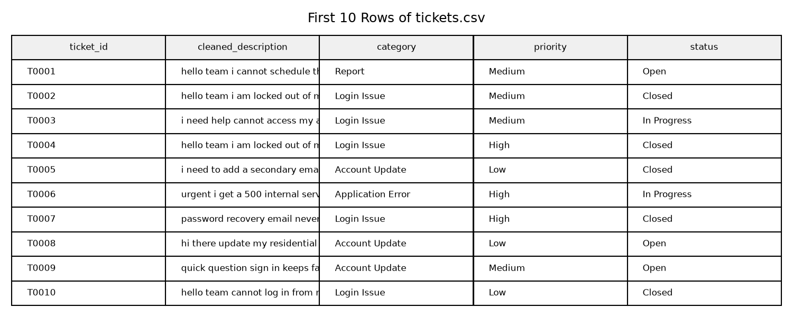
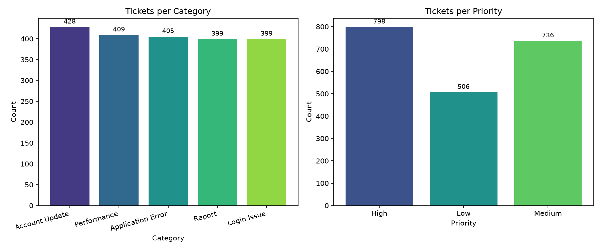
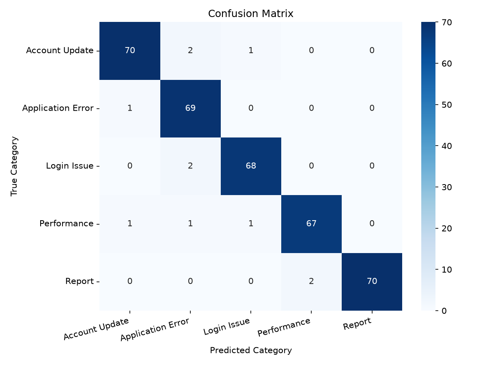

# Customer Support Ticket Classifier

Debargha Chowdhury | AI/ML Fresher Assignment

A small machine-learning project that reads the description of a customer support ticket and predicts which category it belongs to. It comes with a command-line predictor and a simple Flask web page.

## Project Overview

A support team gets tickets from email, chat and other channels. Sorting them by hand is slow, so the idea is to predict the category of a new ticket from its text alone.

The pipeline is deliberately simple, because I wanted to be able to explain every step:

```
ticket description -> text cleaning -> TF-IDF -> Naive Bayes -> category + confidence
```

What is in the project:

- a script that generates a synthetic ticket dataset
- a preprocessing script (cleaning, missing values, duplicates)
- an EDA script that makes the charts
- training and evaluation of the model
- a command-line predictor
- a Flask web page that shows the category, the confidence and a suggested reply

## Problem Statement

Given the description of a support ticket, predict one of five categories:

1. Login Issue
2. Application Error
3. Report
4. Account Update
5. Performance

Nothing else is used as input, only the description text. This is a learning project and not a production system.

## Technologies Used

Python, pandas and numpy for the data, scikit-learn for the model, matplotlib and seaborn for the charts, joblib to save the model, and Flask (with plain HTML, CSS and JavaScript) for the web page.

Pinned versions from `requirements.txt`:

| Library | Version |
|---|---|
| Flask | 3.1.3 |
| joblib | 1.6.0 |
| matplotlib | 3.11.2 |
| numpy | 2.5.5 |
| pandas | 3.1.1 |
| scikit-learn | 1.9.1 |
| seaborn | 0.13.2 |

I developed and tested this on Windows with Python 3.14. Because the pinned versions are recent, use a recent Python 3 version.

## Dataset Information

### The dataset I used

I generated my own synthetic dataset with `src/generate_dataset.py` (random seed 42, so it is reproducible). The generator was written with help from AI tools (see "AI Tools Used" below). It builds tickets from templates for each category.

- Rows: 2,060 raw, 2,040 after cleaning (20 tickets with an empty description were dropped)
- Fields: `ticket_id`, `ticket_description`, `category`, `priority`, `status`, plus `cleaned_description`, which is added during preprocessing
- Tickets per category after cleaning: Account Update 428, Performance 409, Application Error 405, Report 399, Login Issue 399

I did not want perfectly clean data, so I added some real-world mess on purpose:

- about 6% ambiguous tickets that mix words from neighbouring categories
- about 8% light noise (typos, random capital letters, exclamation marks, double spaces)
- 2% wrong labels
- about 3% repeated tickets
- 2% missing priority, 1.5% missing status, 1% missing description

Priority depends on the category (for example Login Issue is 60% High, 30% Medium, 10% Low). Status is 35% Open, 25% In Progress, 40% Closed.

The honest caveat: since the data comes from templates, each category has its own typical vocabulary. Real tickets are messier, so the accuracy below is better than what I would expect on real data.

### A public dataset I tried first

I started with the Kaggle dataset "Customer Support Ticket Dataset" by suraj520:
https://www.kaggle.com/datasets/suraj520/customer-support-ticket-dataset

Modifications: I took a 2,500-row sample, kept five columns, cleaned the text and replaced the template placeholders in the descriptions with plain words.

It did not work. A TF-IDF + Logistic Regression baseline scored 0.222 accuracy, against 0.200 for random guessing and 0.207 for always predicting the most common class. There were 28 cases of the same description under different categories, and the descriptions were generic template sentences. The labels had no usable link to the text, so no model could learn from it. That is why I switched to the synthetic data. The Kaggle data is not used by the final model and is not part of this submission.

## Project Structure

```
data/
    tickets.csv              final dataset (2,040 rows)
    metrics.txt              test results from the last training run
model/
    ticket_classifier.joblib trained pipeline
    labels.txt               category names
src/
    generate_dataset.py      creates the synthetic data
    preprocessing.py         cleaning and data preparation
    eda.py                   statistics and charts
    train.py                 training and evaluation
    predict.py               command-line predictor
    responses.py             suggested replies per category
    app.py                   Flask backend
    templates/index.html     web page
    static/style.css
    static/script.js
screenshots/                 dataset, analysis, confusion matrix, prediction, interface
requirements.txt
report.pdf
```

Some scripts also write helper files when you run them (`data/raw_tickets_synthetic.csv`, `data/prepare_summary.txt`, `data/eda_summary.txt`).

## Installation

Run everything from the project root folder.

Windows (PowerShell):

```powershell
python -m venv .venv
.venv\Scripts\Activate.ps1
pip install -r requirements.txt
```

If PowerShell refuses to run the activate script, run this once and try again:

```powershell
Set-ExecutionPolicy -ExecutionPolicy RemoteSigned -Scope CurrentUser
```

macOS / Linux:

```bash
python3 -m venv .venv
source .venv/bin/activate
pip install -r requirements.txt
```

The virtual environment is optional, but it keeps the libraries of this project separate from the rest of your system.

## How to Train

The trained model is already included in `model/`, so you can skip straight to prediction. To rebuild everything from scratch, run the steps in this order:

```bash
python src/generate_dataset.py    # creates the raw synthetic data
python src/preprocessing.py       # cleans it and writes data/tickets.csv
python src/eda.py                 # statistics and charts into screenshots/
python src/train.py               # trains, evaluates, saves the model
```

After training you should see 2,040 rows, a test accuracy of 0.9690 and a macro F1 of 0.9690. The results are also written to `data/metrics.txt`. Everything uses a fixed seed, so the numbers should repeat.

## How to Predict

```bash
python src/predict.py
```

Type a ticket description and press Enter. Type `quit` to exit.

```
Enter Ticket Description (or type quit to exit): I forgot my password and cannot login
Predicted Category: Login Issue
Confidence: 95.7%
Top 3 probabilities:
  Login Issue: 95.7%
  Account Update: 2.0%
  Report: 1.1%
```

The confidence is the highest class probability from the model. If it is below 50%, the ticket is flagged for manual review, because the model is not sure.

## How to Run the Web Application

```bash
python src/app.py
```

Open http://127.0.0.1:5000 in your browser, type a ticket description and click Predict. The page shows the predicted category, the confidence and a suggested reply with a Copy button. The suggested replies are fixed texts per category (in `src/responses.py`), not generated by an AI model. Press Ctrl+C in the terminal to stop the server.

If the page does not show new results after you changed something, an old server may still be running on port 5000. Stop it and start again.

Example:

- Input: `I forgot my password and cannot login`
- Output: Login Issue, 95.7% confidence, with a suggested reply about resetting the password

## Screenshots

Web interface:


Prediction on a new ticket:


Dataset preview, charts and confusion matrix:







## Model

- Algorithm: Multinomial Naive Bayes
- Features: TF-IDF on the cleaned text, with single words and two-word phrases (`ngram_range=(1,2)`), `min_df=2` and `sublinear_tf=True`
- Cleaning: lowercase, remove URLs and e-mail addresses, keep only letters, digits and spaces, collapse extra spaces

Why Naive Bayes: I compared it with Logistic Regression using 5-fold cross-validation on the training data. Both scored 0.9669 macro F1, so it was a tie. I went with Naive Bayes by a tie-break rule. It is simple, fast and works well with word-weight features.

Other details:

- Split: 80% train, 20% test, stratified, `random_state=42`
- Before splitting I removed 267 rows with duplicate cleaned text, so the same sentence cannot be in both train and test
- Final split: 1,418 training rows and 355 test rows
- The test set was used once, at the end

## Results

Results on the 355 test tickets:

| Metric | Value |
|---|---|
| Accuracy | 0.9690 |
| Precision (macro) | 0.9694 |
| Recall (macro) | 0.9691 |
| F1 (macro) | 0.9690 |
| Precision (weighted) | 0.9696 |
| Recall (weighted) | 0.9690 |
| F1 (weighted) | 0.9691 |

In plain words: the model got about 97 out of 100 test tickets right (344 of 355).

Confusion matrix (rows are the true category, columns are the predicted one):

| True \ Predicted | Account Update | Application Error | Login Issue | Performance | Report |
|---|---|---|---|---|---|
| Account Update | 70 | 2 | 1 | 0 | 0 |
| Application Error | 1 | 69 | 0 | 0 | 0 |
| Login Issue | 0 | 2 | 68 | 0 | 0 |
| Performance | 1 | 1 | 1 | 67 | 0 |
| Report | 0 | 0 | 0 | 2 | 70 |

Most mistakes are between neighbouring categories, such as Performance and Application Error, mostly on the tickets I made ambiguous on purpose.

## Testing on New Tickets

I wrote 12 tickets by hand, two per category plus some ambiguous ones, worded differently from the generator templates. I checked that none of them is in the dataset.

| # | Ticket | Expected | Predicted | Confidence | Result |
|---|---|---|---|---|---|
| 1 | I can't get into my account because my password was rejected | Login Issue | Login Issue | 62.9% | PASS |
| 2 | The sign-in screen won't accept my credentials after the update | Login Issue | Login Issue | 88.1% | PASS |
| 3 | The software crashes every time I try to upload a file | Application Error | Application Error | 39.4% | PASS |
| 4 | Getting a server error when I click the submit button | Application Error | Application Error | 81.6% | PASS |
| 5 | Can you send me the Q3 financial report in PDF format? | Report | Report | 93.1% | PASS |
| 6 | I need to export last month's sales data to a spreadsheet | Report | Report | 92.1% | PASS |
| 7 | Please change my home address in your system | Account Update | Account Update | 94.8% | PASS |
| 8 | I want to update my phone number on my profile | Account Update | Account Update | 97.5% | PASS |
| 9 | The website takes forever to load during busy times | Performance | Performance | 91.4% | PASS |
| 10 | Everything is running slowly since the latest update | Performance | Performance | 72.0% | PASS |
| 11 | The report page won't load and it's very slow | Performance | Performance | 78.4% | PASS |
| 12 | I can't log in and the app is showing an error message | Login Issue | Login Issue | 66.6% | PASS |

12 out of 12 were correct. Ticket 3 had only 39.4% confidence, so the system would send it for manual review.

## Limitations

- The data is synthetic and built from templates, so 96.9% is optimistic. Real tickets would score lower.
- The vocabulary is small and controlled, so the model may not generalise to real tickets.
- The choice between Naive Bayes and Logistic Regression was a tie (0.9669 vs 0.9669).
- 2% of the labels are wrong on purpose, which caps the best possible accuracy.
- Ambiguous tickets confuse the model, as intended.
- The suggested replies are fixed texts, not generated.
- I never tested it on real production tickets.

## What I Would Do Next

Use real ticket data, add more categories, improve the text cleaning (spelling correction), compare Logistic Regression or an SVM again on real data, try sentence embeddings or a BERT model, and retrain regularly with feedback from the support team.

I reviewed the outputs and I can explain the code. No API keys or credentials are in this project.
